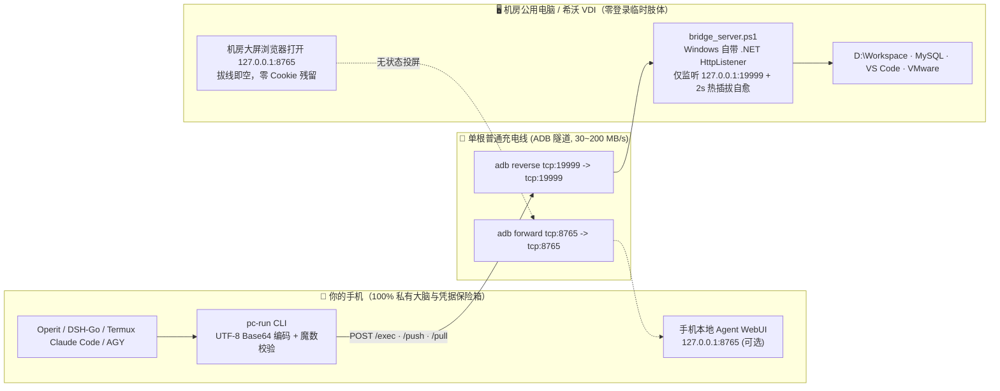

# Phone Agent Bridge (`phone-agent-bridge`)

> **把大脑和私人凭据 100% 锁在兜里的手机上，让机房/办公公用电脑变成「插线即用、拔线失忆」的高速外接肢体——面向 Operit / DSH-Go / Termux / Claude Code / Antigravity 玩家的跨端桥接武器库**

[-16a34a?style=flat-square)](https://github.com/zou-handy/phone-agent-bridge/releases/tag/v1.0.0)
[](LICENSE)
[](#)
[](#)

**一键离线包直链（内置官方 `adb.exe`，`3.9 MB`，揣进手机就能去上课）**：  
👉 **[下载 `Classroom_USB_Kit_v1.0.0.zip` (GitHub Releases)](https://github.com/zou-handy/phone-agent-bridge/releases/download/v1.0.0/Classroom_USB_Kit_v1.0.0.zip)**

---

## 一、核心主打：公用机房电脑「一线零登录反控」(`classroom-usb-kit/`)

### 1. 真实痛点：上机课的「五斤板砖 vs 裸奔社死」两难

每逢数据库、大数据、软件工程实验课或临时借用公共办公电脑，开发党都会撞上同一个死局：

- **不想背电脑**：为了两节 90 分钟的实验课，背五斤重的游戏本 + 板砖电源穿越大半个校区，纯属体力惩罚；
- **不敢登账号**：机房电脑（如希沃云桌面 VDI / 还原卡影子系统）装满教学监控代理，且每次下课重启 `C:\` 盘瞬间恢复出厂。在公用电脑上扫码登微信、登 GitHub、登网盘，或者把自己的大模型 API Key / 长期记忆库配进电脑——轻则下课全被还原清零，重则突发断电忘退号导致私人凭据在全班面前裸奔。

### 2. 连环试错与反转：为什么「校园网 SSH」和「传统远控 CLI」全翻车？

我们把市面上能想到的常规路子全在真实希沃云桌面机房里踩了一遍，结果连环撞墙：

- **第一坑：连校园网 Wi-Fi 走 SSH 直连机房电脑？直接撞墙！**
  1. **三层跨网段隔离**：机房有线教学网（VLAN）与学生手机连接的校园无线 Wi-Fi 隔着核心交换机单向 ACL / AP 隔离，二层 mDNS 根本扫不到，直接 `ping` 座位 IP 100% 超时；
  2. **还原卡重装税 + UAC 拦截**：机房 Windows 默认根本没装 `OpenSSH Server`，安装需管理员提权 + 联网拉包 + 改防火墙，下课一重启全部灰飞烟灭；
  3. **`.NET CLR` 冷启动拖慢**：无连接复用时每次跑短命令都要冷启动 `powershell.exe`（`300~800ms`），Agent 连续调几十次工具卡成幻灯片。
- **第二坑：在机房装电脑版 Agent 或用传统无头远控 CLI？死得更惨！**
  1. **架构完全反了（「脑在电脑，壳在手机」）**：绝大多数远程插件要求在目标电脑上装满 Node.js / Python / Docker 并填入 API Key，等于把身家性命交给了公用机；
  2. **伪终端 `ConPTY` 折行吞字与 `2001` 断流**：传统无头远控终端按屏幕列宽强行折行并回显输入流（Echo），一旦发送带复杂引号的 SQL 或中文路径就被静默吞字，甚至偶发断流报错；
  3. **最致命的 `400` 死锁**：传统 CLI 没有独立二进制文件传输通道！一旦让 Agent 在终端 `stdout` 裸打实验截图 Base64（混入终端回显杂质），或借道云端代码片段传图超过 `1MB` 触发静默腰斩（`truncated: true`），半截损坏的图片喂给多模态视觉接口立刻抛出 `INVALID_ARGUMENT (HTTP 400)`，把整条 Agent 会话永久锁死！

### 3. 底层顿悟：「脑机分离」反向回环架构（Brain on Phone, Ephemeral Limb on PC）

既然公用电脑每节课都会失忆，**为什么非要把「大脑」塞进电脑里？**

反过来想——你兜里那台装着 **Operit / DSH-Go / Termux Claude Code / Antigravity** 的安卓手机，本来就是全天候在线、拥有完整个人记忆库与账号授权的「满血私人大脑」！公用电脑只需要当一条**「插线听令、拔线失忆」的纯执行肢体**：



#### 四大真机打磨的工程护甲：
1. **UTF-8 Base64 + `-EncodedCommand` 双重防吞字装甲（`10~30ms` 热响应）**：
   - 手机端 `pc-run` 与电脑端常驻 `HttpListener` 全链路采用 UTF-8 Base64 + PowerShell `-EncodedCommand` 传递指令，彻底免疫 Windows `CP936` 双字节编码吞引号与 PowerShell `$$` 自动变量篡改 MySQL `DELIMITER $$` 的暗坑；常驻进程省去 SSH 握手开销，单次响应仅 `10~30ms`。
2. **原生二进制 `/push` & `/pull` 直传（告别 BOM 与 `400` 坏图死锁）**：
   - `pc-run --push` 以原生字节流直写电脑磁盘（自动剥离 `.py` / `.sql` 的 `\xEF\xBB\xBF` UTF-8 BOM）；
   - `pc-run --pull` 走 USB 总线（实测 `30~200 MB/s`，单张实验截图 ~4ms）原样拉回手机 `/tmp/`，并**强制校验 JPEG (`FF D8..FF D9`) 与 PNG (`89 50 4E 47`) 头尾魔数**，坏图绝不进上下文。
3. **纯回环 `127.0.0.1` 零弹窗 + 2 秒热插拔断线自愈**：
   - 电脑端仅绑定 `127.0.0.1:19999`（绝不绑 `0.0.0.0`），不弹 Windows 防火墙管理员 UAC，同机房隔壁座位 100% 扫不到；内置后台 2 秒看门狗，课间拔手机去洗手间或上讲台，回座插线 **2 秒自动重连**。
4. **无状态大屏 WebUI 映射（`adb forward tcp:8765`）**：
   - 如果你的手机 Agent 提供本地 Web 面板（如 `8765` 端口），插线后直接在机房大显示器打开 `http://127.0.0.1:8765/` 即可大屏打字交互——所有历史与密钥全在手机内存里，下课拔线关窗，公用电脑上**零登录态、零缓存残留**。

---

### 4. 三步开箱即用（`< 15 秒` 接管实训机）

#### 第 1 步：把 `pc-run` 装进你的手机 Agent 容器（只需一次）
```bash
git clone https://github.com/zou-handy/phone-agent-bridge.git
cd phone-agent-bridge

# Operit (PRoot Ubuntu) / Linux 容器 / Antigravity 用户：
cp classroom-usb-kit/phone-side/pc-run /usr/local/bin/pc-run && chmod +x /usr/local/bin/pc-run

# Termux (Claude Code / DSH-Go / Gemini CLI) 用户：
cp classroom-usb-kit/phone-side/pc-run "$PREFIX/bin/pc-run" && chmod +x "$PREFIX/bin/pc-run"
```
同时下载 Release 里的 **[`Classroom_USB_Kit_v1.0.0.zip` (`3.9 MB`)](https://github.com/zou-handy/phone-agent-bridge/releases/download/v1.0.0/Classroom_USB_Kit_v1.0.0.zip)** 解压到手机内部存储根目录 `/sdcard/Classroom_USB_Kit/`（包内已附带 Google 官方 Windows `platform-tools` 的 `adb.exe`、`AdbWinApi.dll`、`AdbWinUsbApi.dll`；若自行从源码组装，从 [Android 官方 Platform-Tools](https://developer.android.com/tools/releases/platform-tools) 拷入这 3 个文件即可）。

> 💡 **挂载 Agent 技能包**：将 [`classroom-usb-kit/SKILL.md`](classroom-usb-kit/SKILL.md) 放入 `~/.claude/skills/classroom-pc-usb/SKILL.md`、`~/.gemini/skills/classroom-pc-usb/SKILL.md` 或导入 **Operit / DSH-Go** 技能目录，Agent 即可自动习得希沃 VDI 避坑、DPI 1:1 对齐与相册防污染 SOP！

#### 第 2 步：到机房插线双击（`< 10 秒`）
1. 用普通数据线把手机插上机房电脑，手机端选 **「文件传输 (MTP)」** 并开启 **「USB 调试」**（若是希沃云桌面 VDI，在顶部菜单栏勾选挂载手机 USB 设备）；
2. 打开「此电脑 -> 手机内部存储」，把 `Classroom_USB_Kit` 文件夹拖进电脑不还原的 **`D:\Classroom_USB_Kit\`**；
3. 双击运行 **`1_开启电脑被控桥(插线双击即可).bat`**（手机首次弹窗点「允许 USB 调试」）。

#### 第 3 步：在手机 Agent 里直接发号施令！
```bash
# 1. 毫秒级连通性探测
pc-run --ping
# -> [pc-run] OK: pong from Lab-PC (cwd=D:\)

# 2. 在机房电脑执行任意 PowerShell / 编译 / MySQL 查询 / 调起 VS Code
pc-run "Get-ChildItem D:\Workspace | Select-Object Name, Length"
pc-run "code D:\Workspace\DatabaseLab"

# 3. 零 BOM 推送 SQL/Python 脚本到电脑 D 盘
pc-run --push /tmp/proc_lab.sql "D:\Workspace\proc_lab.sql"

# 4. 二进制无损拉回电脑截图或报告（自动校验 JPEG/PNG 魔数，绝不污染上下文）
pc-run --pull "D:\Workspace\navicat_result.jpg" /tmp/navicat_result.jpg
```

---

## 二、移动端 Agent 四大原生超能力 (`scripts/`)

除了机房 USB 反控套件，本仓库还开源了在真机（Android 13–16 / ColorOS 16 + PRoot Ubuntu / Termux）上深挖系统底层 API 打磨出的四大移动端 Agent 原生外设工具：

```text
phone-agent-bridge/
├── classroom-usb-kit/                  # ★ 核心主打：公用电脑 USB 零登录反控套件
│   ├── 1_开启电脑被控桥(插线双击即可).bat   # 纯 ASCII + CRLF 一键启动器（防 CP936 吞引号）
│   ├── start_bridge.bat                # 纯英文文件名备用启动器
│   ├── bridge_server.ps1               # Windows 原生 HttpListener (/ping, /exec, /push, /pull) + 2s 自愈看门狗
│   ├── SKILL.md                        # Operit / DSH-Go / Termux Claude Code / AGY 通用技能规范
│   └── phone-side/
│       └── pc-run                      # 手机端零依赖 Python 执行器（UTF-8 Base64 + 魔数校验）
└── scripts/                            # ★ 移动端 Agent 原生系统超能力工具集
    ├── pc-run                          # 与 phone-side/pc-run 同步的快捷入口
    ├── rsh                             # 零延迟本机无线/Shizuku ADB 包装器（默认 -T raw 流免除 \r\n 污染）
    ├── rsh-firewall                    # 零后台、零 VpnService 占用的 Android 13+/16 内核 eBPF 应用联网开关
    ├── launch-mini                     # ColorOS 16 右上角 261x464 贴边迷你小窗 (state=2) 零触摸唤醒器
    ├── connect_mobile_edge.sh          # 手机端 Edge 迷你小窗保活 + 9222 CDP 映射（复用日常登录态与扩展）
    ├── connect_mobile_chrome_dev.sh    # 手机端 Chrome Dev 9223 独立套接字干净自测沙箱（零插件干扰，支持 --close）
    └── es_sqlite_cache.py              # Everything (es.exe) NTFS MFT 导出至 SQLite FTS5 零 RTT 目录快照缓存
```

### 超能力 1：ColorOS 16 右上角 `261×464` 贴边迷你小窗保活 (`scripts/launch-mini`)
- **真实痛点**：手机浏览器一旦切入后台，数秒内就会被系统置为 `cached=true` 冻结渲染进程与 CDP 套接字；而标准 Android 自由浮窗（`--windowingMode 5`）在已有全屏任务时会被忽略，或弹出 `873×1552` 居中大窗挡住手机屏幕。
- **底层绝杀**：逆向 `FlexibleTaskController` 窗口参数，传入 `--windowingMode 100` + `LaunchScenario=1` + `LaunchScale=0.24166666` 并紧接 `cmd activity task resize <TASK_ID> 759 120 1839 2040`，零触摸直接把目标 App 钉在屏幕右上角 `261×464` 迷你小窗（`state=2`）——既保持前台活跃渲染，又不挡视线、不抢触控焦点。

### 超能力 2：手机双浏览器并行 CDP 架构 (`9222` 日常复用 × `9223` 纯净自测沙箱)
- **`scripts/connect_mobile_edge.sh` (`127.0.0.1:9222`)**：将手机端 **Microsoft Edge (`com.microsoft.emmx`)** 唤醒至右上角迷你小窗并映射完整 Chromium CDP 接口，支持复用已有网页登录状态与 Tampermonkey 等扩展。
- **`scripts/connect_mobile_chrome_dev.sh` (`127.0.0.1:9223`)**：通过 `/data/local/tmp/chrome-command-line` 为 **Chrome Dev (`com.chrome.dev`)** 指定独立抽象域套接字 `@chrome_dev_remote`，与 Edge `9222` **100% 并行零冲突**！专为 Agent 开发 WebUI 时的自动化 DOM 自测与性能剖析打造，零第三方插件污染，测完执行 `./scripts/connect_mobile_chrome_dev.sh --close` 自动收起小窗零残留。

### 超能力 3：零后台、零 `VpnService` 占用的内核级 eBPF 联网开关 (`scripts/rsh-firewall`)
- **底层原理**：无需安装任何第三方防火墙 APK，直接通过本机 `rsh` (`uid=2000` shell) 调用 Android 13+/16 原生 `cmd connectivity` 的 **`chain3` (`FIREWALL_CHAIN_OEM_DENY_3`) 内核 eBPF `sUidOwnerMap`**，按 UID 在内核态精准开关纯离线工具 App 的联网权限。
- **安全护栏**：内置预检拦截器，严禁误锁系统核心组件（`UID < 10000`）以及 `operit`、`termux`、浏览器、`shizuku` 等关键宿主包，支持 `status`、`block`、`unblock`、`reapply`（重启恢复）与 `off`（一键紧急旁路）。
  ```bash
  ./scripts/rsh-firewall status
  ./scripts/rsh-firewall block com.example.offline.tool
  ./scripts/rsh-firewall off
  ```

### 超能力 4：云端沙箱远程文件挂载零 RTT 目录检索加速 (`scripts/es_sqlite_cache.py`)
- **底层原理**：针对云端 Agent 沙箱通过 WebSocket 挂载本地磁盘（`go-fuse`）时，递归遍历触发上万次串行 `LOOKUP`/`GETATTR` 放大网络 RTT 的瓶颈，调用本机 Everything CLI (`es.exe`) 直接读取 NTFS MFT 主文件表，毫秒级导入内存 SQLite FTS5 全文索引（检索 `< 2ms`）。
  ```bash
  python3 scripts/es_sqlite_cache.py --root "D:\Workspace" --db workspace_index.db --query "schema.sql"
  ```

---

## 三、兼容的移动端 AI Agent 生态

- **Operit (`com.ai.assistance.operit`)**：内置 PRoot Ubuntu 终端直接放入 `/usr/local/bin/pc-run` 与 `rsh*`，配合 `1×1` 零像素保活丝滑驱动机房电脑与本机浏览器。
- **DSH-Go (`@deepseek-ai/dsh` 移动端)**：弥补移动端 DSH 在无 Node.js / 无管理员权限还原机房公用电脑上的「零安装外接 Windows 肢体」空白。
- **Termux + Claude Code / Gemini CLI / Codex**：放入 `$PREFIX/bin/pc-run` 并挂载 `classroom-usb-kit/SKILL.md`，手机揣兜里用一根充电线打穿实训课全流程。
- **Antigravity CLI (`agy`)**：原生支持 `SKILL.md` 自动触发、双浏览器 CDP 自测闭环与 `adb forward` 无状态 WebUI 大屏投射。

---

## 📄 开源协议

本项目基于 [MIT License](LICENSE) 开源。  
*(注：GitHub Releases 离线一键包中随附的 `adb.exe` / `AdbWinApi.dll` / `AdbWinUsbApi.dll` 来自 Google 官方 Android SDK Platform-Tools，遵循 Apache License 2.0。)*
